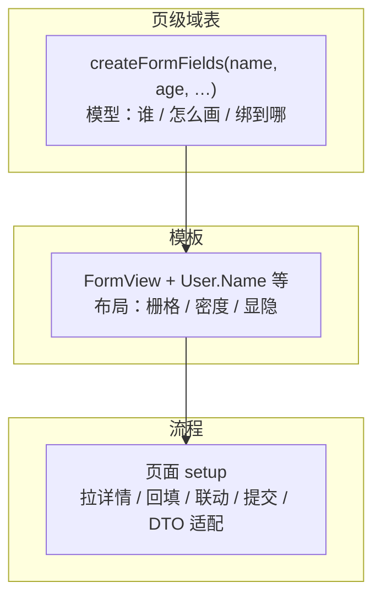

# 简介

vue-formless 是一套**与 UI 库解耦的表单框架**。它不提供表单控件，而是提供把「任意输入组件 + 任意 UI 库的 Form / FormItem / Row / Col」组装成可写表单的**粘合层**。

## 定位

一句话：**用「页级域表 + 命名空间 Field + FormView」表达结构，把布局与定制留在模板里。**

- 它**不是**一个 UI 组件库——不内置 `Input`、`Select`、`DatePicker`，这些由你的 UI 库（Element Plus、Ant Design Vue、Naive UI……）提供。
- 它**不是**一个全量 JSON Schema 引擎——不把布局、联动、校验全部塞进一份运行时配置，那样会丢类型、难调试、DSL 膨胀。
- 它**是**一个组合层——`createFormFields` 声明「谁、怎么画、绑到哪」，`createFormView` 一次绑定宿主 Form / Item / Row / Col，模板负责排版。

## 核心张力与取舍

中后台表单的永恒矛盾是 **Schema 复用 vs Template 定制**。formless 的结论是取平衡：

```text
配置（View-Model） + Template（排版） ≫ 完整 JSON 布局引擎
```

只配置**稳定的模型**（字段 ↔ 默认 control / 元数据），不配置复杂布局 DSL；布局权力交还 Vue Template。模板内还能混写原生表单项作为逃生舱。

## 设计哲学

三条不变的原则：

1. **控件主角**：可摆放单元是 Field（`<User.Name />`），键是控件名（`agency`），不是 DTO 字段名（`agencyId`）。
2. **formless 只跟自己的壳交互**：内核只见 `LayoutView` / `LayoutItem` / 宿主 `Item`，不见 Row / Col；Row / Col 是布局包内部的事。
3. **写口就是 v-model**：FormView 以 Vue 常规 `v-model` 接入可写状态，不是 `v-model:fl` 或 `fl.modelValue`。

## 一张图看懂三层拆解



## 与官方文档的关系

本网站是**面向使用者的文档**。设计决策的完整推演（每个方案「为什么这么做、否掉了什么」）沉淀在仓库内的：

- [`docs/design.md`](https://github.com/xuyimingwork/vue-formless/blob/main/docs/design.md) —— 完整设计规格
- [`docs/adr.md`](https://github.com/xuyimingwork/vue-formless/blob/main/docs/adr.md) —— 架构决策汇总
- [`docs/decision.md`](https://github.com/xuyimingwork/vue-formless/blob/main/docs/decision.md) —— 早期决策问答
- [`docs/functional-props.md`](https://github.com/xuyimingwork/vue-formless/blob/main/docs/functional-props.md) —— 函数式 props 梳理

本站正文按需提炼、引用，不整篇复制。

## 版本说明

当前版本 **0.2.0**。`0.x` 期间 API 仍可能调整，破坏性变更会在 [CHANGELOG](https://github.com/xuyimingwork/vue-formless/blob/main/CHANGELOG.md) 中标注。

## 下一步

- [安装](/guide/installation)
- [快速上手](/guide/quick-start)
- [与其他方案对比](/guide/comparison)
